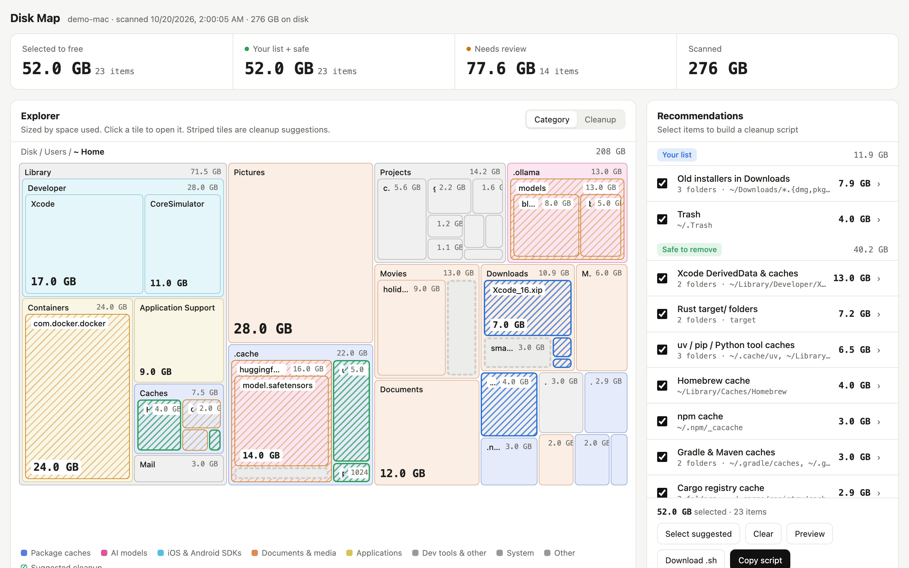

# macOS Disk Analyzer

A fast Python tool to analyze your macOS disk usage and identify large directories that can be safely cleaned to free up space.

It uses [ncdu](https://dev.yorhel.nl/ncdu) to scan your filesystem and export a JSON snapshot, then analyzes that snapshot to surface cleanable build artifacts, caches, and dependencies grouped by type.

## Features

- Identifies large **node_modules**, **Rust target**, **.venv**, **Maven/Gradle** caches, and more
- Groups similar directories and shows aggregated totals
- Exports per-category path lists (sorted by size) so you can delete selectively
- Deduplicates APFS mount points (`/System/Volumes/Data`) automatically
- Runs entirely offline — no data leaves your machine

## Prerequisites

### Install ncdu

**Homebrew (recommended)**
```bash
brew install ncdu
```

**MacPorts**
```bash
sudo port install ncdu
```

Verify the installation:
```bash
ncdu --version
```

### Python

Python 3.7+ is required. The script uses [uvx](https://docs.astral.sh/uv/) to automatically install the `tqdm` dependency at run time, so no manual `pip install` is needed.

Install `uv` (which provides `uvx`) if you don't have it:
```bash
brew install uv
```

## Quick Start

### Step 1 — Scan your disk with ncdu

```bash
sudo ncdu -c -o data/$(hostname)/disk_usage.json.zst /
```

> **Why `-c` (compression)?**  
> `ncdu -c` enables native Zstandard (`zstd`) compression, reducing file size by ~85% (typically from ~350 MB down to ~45 MB per snapshot) with zero noticeable scanning overhead.

> **Why `sudo`?**  
> Running ncdu as root lets it read every directory on your Mac, including system folders and other users' home directories. The scan is **read-only** — ncdu only reads file metadata (names and sizes) and writes the result to the compressed JSON file you specify. No files are modified or deleted.

The scan typically takes 2–10 minutes depending on disk size. You will see a live progress display in your terminal.

### Step 2 — Analyze the output

```bash
uvx --with tqdm python analyze_ncdu_v2.py
```

By default the script reads `data/<hostname>/disk_usage.json.zst` (or legacy `.json`) and writes all output files back to the same directory.

#### Specify a different hostname

```bash
uvx --with tqdm python analyze_ncdu_v2.py --host my-macbook
```

This reads `data/my-macbook/disk_usage.json`.

## Output

The script prints three sections to your terminal:

| Section | Description |
|---------|-------------|
| **Top 30 Largest Files** | The biggest individual files on your disk |
| **Cleanable Directories** | Grouped by type (node_modules, .venv, target, …) with totals and top-10 list |
| **Largest Application & User Directories** | Big entries under `/Applications` and `~/Library` |

It also writes one text file per category inside `data/<hostname>/`:

```
data/<hostname>/cleanable_node_modules_paths.txt
data/<hostname>/cleanable_target_paths.txt
data/<hostname>/cleanable_.venv_paths.txt
...
```

Each file contains tab-separated `<size_gb>  <path>` lines, sorted largest first.

### Example: use the exported path lists

```bash
# Preview what would be deleted
cat data/$(hostname)/cleanable_target_paths.txt

# Delete all Rust target directories (careful!)
awk '{print $2}' data/$(hostname)/cleanable_target_paths.txt | xargs rm -rf

# Delete only directories larger than 500 MB
awk '$1 > 0.5 {print $2}' data/$(hostname)/cleanable_target_paths.txt | xargs rm -rf
```

## Disk map & cleanup suggestions

```bash
make map          # or: uvx python disk_map.py && open data/$(hostname)/disk_map.html
```

`disk_map.py` (Python 3.11+, no dependencies) turns the same scan into an interactive page, `data/<hostname>/disk_map.html`:



*Screenshot built from a synthetic snapshot of a demo user, not a real disk.*

- **Explorer**: a treemap of the disk sized by space used and coloured by category. Click a tile to open it. Striped tiles are cleanup suggestions. **Cleanup** mode greys out everything except suggestions.
- **Recommendations**: grouped as *Your list*, *Safe to remove* and *Review first*. Tick items and the totals update. **Copy script** / **Download .sh** builds a shell script from your selection.
- `data/<hostname>/cleanup_suggested.sh`: the same suggestions as a script. Review items are commented out.

### Your own "usually deletable" list

Put the things you always delete in **`my_cleanup_rules.toml`**. These rules are checked before the built-in ones, are pre-selected, and are listed first:

```toml
[[rule]]
label = "Scratch projects"
paths = ["~/Desktop/sandbox", "~/works/old-*"]   # ~ home, * one segment, **/ any depth, {a,b}

[[rule]]
label = "Keep my HF models"   # protect something the built-in rules would suggest
tier = "keep"
paths = ["~/.cache/huggingface"]
```

The built-in rules live in `cleanup_rules.toml` (npm/uv/Gradle/Cargo caches, Xcode DerivedData, `.next`, Rust `target/` next to a `Cargo.toml`, node_modules, venvs, Ollama models, simulators, …). Each rule can set a `command` (for example `npm cache clean --force`) that runs instead of `rm -rf`. The same file holds the category colours used on the map.

## Cleanable Directory Categories

| Category | Safe to delete? | Notes |
|----------|----------------|-------|
| `node_modules/` | ✅ Yes | Regenerate with `npm install` |
| `.venv/` / `venv/` | ✅ Yes | Regenerate with `pip install` |
| `target/` (Rust) | ✅ Yes | Regenerate with `cargo build` |
| `.npm/` | ✅ Yes | `npm cache clean --force` |
| `.m2/` (Maven) | ✅ Yes | Redownloaded on next build |
| `.gradle/` | ✅ Yes | Redownloaded on next build |
| `__pycache__/` | ✅ Yes | Python regenerates automatically |
| `.cache/` | ✅ Yes | Apps recreate as needed |
| `Library/Caches` | ⚠️ Review | Safe for unused apps |
| `Library/Logs` | ⚠️ Review | Old logs only |
| `.git/` | ⚠️ Caution | Only delete repos you no longer need |

## Snapshots & Comparing Usage Over Time

Track what has been increasing, decreasing, added, or deleted between any two points in time.

### 1. Capture a Snapshot

Use `make snapshot` (or `make scan`) to scan the filesystem and save a dated compressed snapshot:

```bash
make snapshot
# or manually:
sudo ncdu -c -o data/$(hostname)/snapshots/disk_usage_$(date +"%Y-%m-%d_%H%M%S").json.zst /
```

Snapshots are automatically compressed with Zstandard and stored as `data/<hostname>/snapshots/disk_usage_YYYY-MM-DD_HHMMSS.json.zst` (~45 MB instead of ~350 MB raw JSON), and `data/<hostname>/disk_usage.json.zst` is updated to point to the latest snapshot.

> [!TIP]
> If you have older uncompressed `.json` snapshots taking up space, run `make compress-snapshots` (or `python compare_ncdu.py --compress-all`) to convert them to `.json.zst` and reclaim ~85% disk space.

#### Run `make snapshot` Automatically Every Day (macOS LaunchDaemon)

To capture a disk usage snapshot every day at 02:00 AM automatically in the background:

```bash
# Install and enable the daily 02:00 AM snapshot daemon
sudo make schedule-install

# Check schedule status and view recent snapshot logs
make schedule-status

# Test the snapshot runner immediately
sudo make schedule-run

# Uninstall/disable the scheduled daemon
sudo make schedule-uninstall
```

- **Non-intrusive**: Runs with background CPU and low I/O priority.
- **No password prompts**: Runs natively as a system LaunchDaemon so it doesn't prompt for sudo.
- **Sleep-aware**: If your Mac is asleep at 02:00 AM, macOS launchd runs the snapshot as soon as the Mac wakes up.
- **Logs**: Output is saved to `data/snapshot.log`.

### 2. List Available Snapshots

```bash
make snapshots
# or:
uvx --with tqdm python compare_ncdu.py --list
```

Example output:
```text
========================================================================================
AVAILABLE SNAPSHOTS (2 found)
========================================================================================
#    Date & Time          Host             Size       Snapshot Path
----------------------------------------------------------------------------------------
#1   2026-03-30 11:33:32  Viet Vu          298.0 MB   data/Viet Vu/disk_usage.json
#2   2026-09-14 11:19:07  VietVu-02        329.4 MB   data/VietVu-02/disk_usage.json
========================================================================================
```

### 3. Compare Snapshots

Compare the two most recent snapshots automatically:

```bash
make compare
# or:
uvx --with tqdm python compare_ncdu.py
```

#### Compare specific snapshots by index, date, or path:

```bash
# By snapshot index:
make compare BEFORE=1 AFTER=2
# or:
python compare_ncdu.py --before 1 --after 2

# By date:
make compare BEFORE=2026-03-30 AFTER=2026-09-14

# By file path:
python compare_ncdu.py --before "data/Viet Vu/disk_usage.json" --after "data/VietVu-02/disk_usage.json"
```

### 4. Comparison Output

The comparison tool generates a clear breakdown:

1. **Executive Summary**:
   - Total disk usage baseline vs current
   - Net space change ($+\Delta$ GB, percentage change)
   - Itemized counts & total volume for **New Files**, **Deleted Files**, **Increased Files**, **Decreased Files**, and **Same (Unchanged)** files.
2. **Root Directory Changes**:
   - Top-level changes in `/Users`, `/Applications`, `/Library`, `/opt`, `/System`, etc.
3. **Cleanable Categories Comparison**:
   - Before vs After comparison for `node_modules`, `target/`, `.venv/`, `.cache/`, `Library/Caches`, `Library/Logs`, `.git/`, etc.
4. **Top Growing Files**:
   - Files that grew the most (old size $\to$ new size, $+\Delta$).
5. **Top Shrinking Files**:
   - Files that decreased in size the most (old size $\to$ new size, $-\Delta$).
6. **Top New Files & Directories**:
   - Newly created files and newly added project directories.
7. **Top Deleted Files & Directories**:
   - Removed files and deleted project directories.
8. **Top Unchanged (Same) Files**:
   - Largest files that remained identical in size and path.

### 5. Export Detailed Differential Reports & Parquet Diff

Export complete tab-separated path lists and a compressed Parquet diff table for all changed files:

```bash
make compare-export
# or:
python compare_ncdu.py --export
```

This exports files into `data/<hostname>/diffs/<date_before>_to_<date_after>/`:
- `diff.parquet`: Columnar Parquet table of all changed items (`NEW`, `DELETED`, `INCREASED`, `DECREASED`) with full metadata (`path`, `name`, `is_dir`, `category`, `old_bytes`, `new_bytes`, `delta_bytes`, `status`).
- `diff_increased.txt`: `<delta_gb>\t<old_gb>\t<new_gb>\t<path>`
- `diff_decreased.txt`: `<delta_gb>\t<old_gb>\t<new_gb>\t<path>`
- `diff_new.txt`: `<size_gb>\t<path>`
- `diff_deleted.txt`: `<size_gb>\t<path>`
- `diff_same.txt`: `<size_gb>\t<path>`

You can process these with standard Unix tools or query `diff.parquet` directly via DuckDB:
```bash
# Query diff.parquet with DuckDB:
duckdb -c "SELECT status, count(*), ROUND(SUM(delta_bytes)/1e9, 2) as delta_gb FROM 'data/$(hostname)/diffs/*/diff.parquet' GROUP BY status;"

# View the biggest growers
head -20 data/$(hostname)/diffs/*/diff_increased.txt

# Inspect newly added files larger than 1 GB
awk '$1 > 1.0 {print $2}' data/$(hostname)/diffs/*/diff_new.txt
```

### 6. Interactive Diff Shell (`make diff-shell`)

Launch an interactive DuckDB prompt with the `diff` view preloaded between any two snapshots:

```bash
make diff-shell
# or for specific snapshots:
make diff-shell BEFORE=1 AFTER=2
```

From the prompt, you can run any SQL queries directly against the `diff` view:
```sql
-- What grew in my home directory?
SELECT ROUND(delta_bytes/1e9, 2) AS gb, path 
FROM diff 
WHERE status = 'INCREASED' AND path LIKE '/Users/%' AND NOT is_dir 
ORDER BY delta_bytes DESC LIMIT 10;

-- What was cleaned up or shrank?
SELECT ROUND(-delta_bytes/1e9, 2) AS freed_gb, path 
FROM diff 
WHERE status = 'DECREASED' AND NOT is_dir 
ORDER BY delta_bytes ASC LIMIT 10;

-- Summary by status
SELECT status, count(*), ROUND(SUM(delta_bytes)/1e9, 2) AS delta_gb 
FROM diff 
GROUP BY status;
```

## Fast SQL Analytics with Parquet & DuckDB

While `ncdu` native `.json.zst` snapshots (~45 MB) are ideal for interactive TUI exploration (`ncdu -f`), querying millions of filesystem entries using standard JSON parsers takes several seconds.

You can convert any snapshot to **Parquet format** using DuckDB. Parquet provides a columnar, typed schema compressed with Zstandard, enabling sub-second analytical queries across millions of files.

### 1. Export Snapshot to Parquet

```bash
make parquet
# or directly:
python compare_ncdu.py --to-parquet
```

This streams the JSON snapshot into DuckDB and generates `data/<hostname>/disk_usage.parquet` (~80 MB for ~3.4 million records) with the following schema:

| Column | Type | Description |
|--------|------|-------------|
| `path` | `VARCHAR` | Normalized absolute file or directory path |
| `name` | `VARCHAR` | Base filename or folder name |
| `size_bytes` | `BIGINT` | Apparent size in bytes |
| `is_dir` | `BOOLEAN` | `true` for directories, `false` for files |
| `depth` | `INTEGER` | Directory depth level from root |
| `extension` | `VARCHAR` | Lowercase file extension (e.g., `.dmg`, `.mp4`, `.zip`) |
| `category` | `VARCHAR` | Pre-classified category (`node_modules`, `target`, `venv`, `caches`, `logs`, `git`, `pycache`, `other`) |

### 2. Interactive DuckDB Shell

Open an interactive SQL session on the latest Parquet dataset:

```bash
make duckdb
```

### 3. Quick Ad-hoc Queries via Command Line

Run queries directly from your shell:

```bash
# Default category breakdown:
make sql

# Custom query:
make sql QUERY="SELECT extension, count(*) as files, ROUND(SUM(size_bytes)/1e9, 2) as gb FROM 'data/$(hostname)/disk_usage.parquet' WHERE NOT is_dir AND extension != '' GROUP BY extension ORDER BY gb DESC LIMIT 10;"
```

### 4. Useful SQL Query Examples

#### Cleanable Categories Breakdown (runs in ~65ms)
```sql
SELECT 
    category,
    count(*) AS items,
    ROUND(SUM(size_bytes) / 1024 / 1024 / 1024, 2) AS total_gb
FROM 'data/VietVu-02/disk_usage.parquet'
WHERE category != 'other'
GROUP BY category
ORDER BY total_gb DESC;
```

#### Top 10 Largest Individual Files
```sql
SELECT 
    ROUND(size_bytes / 1024 / 1024 / 1024, 2) AS size_gb,
    path
FROM 'data/VietVu-02/disk_usage.parquet'
WHERE NOT is_dir
ORDER BY size_bytes DESC
LIMIT 10;
```

#### Top Disk Space by File Type (Extensions)
```sql
SELECT 
    extension,
    count(*) AS file_count,
    ROUND(SUM(size_bytes) / 1024 / 1024 / 1024, 2) AS total_gb
FROM 'data/VietVu-02/disk_usage.parquet'
WHERE NOT is_dir AND extension != ''
GROUP BY extension
ORDER BY total_gb DESC
LIMIT 15;
```

#### Find All node_modules or Caches in Home Directory
```sql
SELECT 
    ROUND(size_bytes / 1024 / 1024, 1) AS size_mb,
    path
FROM 'data/VietVu-02/disk_usage.parquet'
WHERE is_dir AND category = 'node_modules' AND path LIKE '/Users/%'
ORDER BY size_bytes DESC
LIMIT 20;
```

## Project Structure

```
.
├── Makefile             # Convenient targets (snapshot, compare, parquet, duckdb, sql, map)
├── analyze_ncdu_v2.py   # Analysis script for single snapshots
├── compare_ncdu.py      # Time-comparison script and Parquet exporter
├── disk_map.py          # Interactive disk map + cleanup suggestions
├── disk_map_template.html  # Page template used by disk_map.py
├── cleanup_rules.toml   # Built-in "usually deletable" rules + map categories
├── my_cleanup_rules.toml   # YOUR rules: matched first, listed first
├── scripts/             # LaunchDaemon plist + daily snapshot runner
└── data/
    └── <hostname>/
        ├── disk_usage.json.zst      # Symlink / pointer to latest compressed snapshot
        ├── disk_usage.parquet       # Typed Parquet table for DuckDB analytics
        ├── snapshots/               # Dated compressed snapshots (Zstandard)
        │   └── disk_usage_YYYY-MM-DD_HHMMSS.json.zst
        ├── diffs/                   # Exported diff reports
        │   └── YYYY-MM-DD_to_YYYY-MM-DD/
        │       ├── diff.parquet     # Compressed Parquet table of all changed files
        │       ├── diff_increased.txt
        │       ├── diff_decreased.txt
        │       ├── diff_new.txt
        │       ├── diff_deleted.txt
        │       └── diff_same.txt
        ├── disk_map.html            # Generated map (not committed)
        ├── cleanup_suggested.sh     # Generated script (not committed)
        └── cleanable_*_paths.txt    # Generated category path lists
```

## License

MIT

